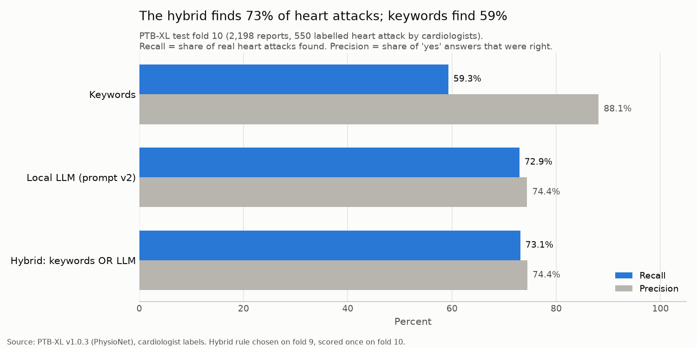
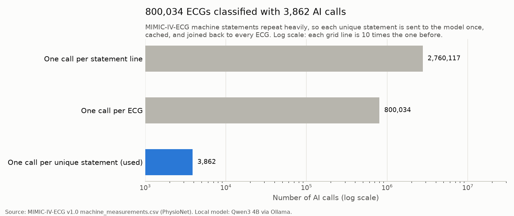
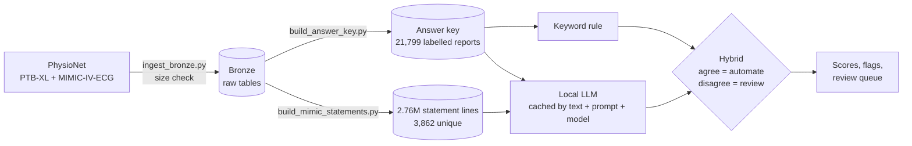

# ECG Report Structuring Pipeline

**Can an AI model read free-text ECG reports and flag heart attacks reliably, at hospital scale?**

Doctors write ECG findings as free text, like "sinus rhythm, possible old inferior infarct", sometimes
in German or Swedish. A computer cannot count or filter that. I built a pipeline that reads these
reports, flags heart attack (myocardial infarction) yes or no, and measures how accurate it is against
cardiologists' labels. Then I ran it on 800,034 real hospital ECGs.

**Short answer:** a small local AI model, used carefully, finds more heart attacks than keyword search
(73% vs 59%). Used carelessly, it made the data worse. Most of the work was making the AI's output
trustworthy, repeatable and cheap.



## What I found

### 1. Accuracy, measured against cardiologists (PTB-XL test fold, 2,198 reports)

| Method | Heart attacks found (recall) | Correct when it says yes (precision) | F1 |
|---|---|---|---|
| Keyword search ("infarct", "infarkt") | 59.3% | 88.1% | 0.709 |
| Local AI model, prompt v2 | 72.9% | 74.4% | 0.736 |
| **Hybrid: keywords OR AI** | **73.1%** | **74.4%** | **0.738** |

- The hybrid rule was chosen on fold 9 (validation) and scored once on fold 10 (test). Fold 9 gave
  F1 0.743 and fold 10 gave 0.738, so the result is not tuned to the test set.
- Where keywords and the AI agree (92% of reports), they are correct 90.5% of the time. The 7.8% where
  they disagree are flagged for human review instead of guessed.
- Honest note: the hybrid is almost the same as the AI alone. Keywords add very little once the AI is there.

Evidence: [eval_keywords_fold10.txt](docs/results/eval_keywords_fold10.txt),
[eval_llm_v2_fold10.txt](docs/results/eval_llm_v2_fold10.txt), [hybrid_fold10.txt](docs/results/hybrid_fold10.txt)

### 2. Scale: 800,034 ECGs with 3,862 AI calls



The hospital's ECG machine writes from a fixed set of sentences. 2,760,117 statement lines contain only
3,862 different statements. So I send each unique statement to the model once, store the answer, and
join it back to every ECG. On my laptop that took about 22 minutes. One call per line would take about
11 days at the same speed.

| | Result |
|---|---|
| ECGs processed | 800,034 |
| Flagged by keywords / AI / hybrid | 179,588 / 182,132 / 182,137 |
| Sent to human review (methods disagree) | 2,554 (0.3%) |
| Invalid AI answers | 0 |

Evidence: [mimic_classification.txt](docs/results/mimic_classification.txt)

### 3. The catch keyword search missed

The statement **"\*\*\* CONSIDER ACUTE ST ELEVATION MI \*\*\*"** appears 8,723 times. It is the machine
warning of a possible heart attack happening now. Keyword search missed it because it says "MI", not
"infarct". The AI caught it.

## How it works



| Step | Script | What it does |
|---|---|---|
| Load | `src/ingest_bronze.py` | Loads raw CSVs to Parquet. Refuses a file until it has its full expected size |
| Answer key | `src/build_answer_key.py` | Turns cardiologist codes into one row per report: heart attack yes/no and the doctor's certainty |
| Baseline | `src/predict_keywords.py` | Keyword search for "infarct" / "infarkt" |
| AI | `src/predict_llm.py` | Asks a local model (Qwen3 4B via Ollama) about each unique report once, caches the answer and raw output |
| Hybrid | `src/hybrid.py` | Picks a combining rule on fold 9, scores it once on fold 10, flags disagreements |
| Scale | `src/build_mimic_statements.py`, `src/classify_mimic.py` | Reshapes 800K ECGs to statement rows, classifies unique statements, joins back |
| Score | `src/evaluate.py` | Scores any prediction file the same way: recall, precision, F1, recall by doctor certainty |

## Problems I ran into and how I fixed them

### The first AI version made things worse
On 200 random reports, the AI scored F1 0.67 against 0.79 for keywords, with 8 times more false
alarms. On the test fold, 195 of its 269 false alarms were ischemia or ST/T changes. My instruction
asked about "infarction or myocardial damage", which was too broad. Prompt v2 defines infarction
precisely and lists what does not count.

### A parser bug turned 108 "yes" answers into "no"
Prompt v2 first scored lower than v1. All 108 of its "invalid" answers started with `{"mi": true`
and then ran into blank space until the token limit cut them off. The strict JSON parser rejected
them and the script counted them as "no". I added a fallback that reads the value even from cut-off
JSON. Because every raw output is stored in the cache, I re-scored everything without a single new
model call.

### A model call that never finished
With temperature 0 and forced JSON, the model sometimes kept generating whitespace forever. A cap of 20
output tokens and a 60-second timeout fixed it.

### Answers change when the prompt changes
185 of 2,198 test answers (8.4%) changed between prompt v1 and v2. Every answer is cached under its
model and prompt version, so versions are compared side by side and never overwritten.

### A half-downloaded file
The 183 MB MIMIC file downloads slowly from PhysioNet. The loader refused it twice while it was still
downloading (68 MB and 71 MB), instead of creating a silently incomplete table.

### Choosing the hybrid without fooling myself
Trying several rules on the test data and keeping the best would inflate the score. I chose the rule on
fold 9 and measured it once on fold 10.

More detail, day by day: [DEVLOG.md](DEVLOG.md)

## What this cannot tell you

- **Labels come from the ECG signal, not only the text.** Some reports are labelled heart attack even
  though the text never says it, so no text method can reach 100%.
- **MIMIC-IV-ECG has no diagnosis labels in this file.** Accuracy is measured on PTB-XL; MIMIC shows
  scale, speed and agreement, not accuracy.
- **MIMIC statements are machine-generated**, not written by a cardiologist.
- **Some AI "yes" answers are arguable**, for example "ST elevation - cannot rule out myocardial
  injury". That is why disagreements go to a person.
- This is a data-engineering study, not a clinical tool.

## Run it yourself

You need Python 3.11+, [uv](https://docs.astral.sh/uv/) and [Ollama](https://ollama.com).

```bash
uv venv && source .venv/bin/activate
uv pip install -r requirements.txt
ollama pull qwen3:4b

mkdir -p data/raw
curl -sSL -o data/raw/ptbxl_database.csv https://physionet.org/files/ptb-xl/1.0.3/ptbxl_database.csv
curl -sSL -o data/raw/scp_statements.csv https://physionet.org/files/ptb-xl/1.0.3/scp_statements.csv
curl -sSL -o data/raw/mimic_machine_measurements.csv https://physionet.org/files/mimic-iv-ecg/1.0/machine_measurements.csv

python src/ingest_bronze.py
python src/build_answer_key.py
python src/predict_keywords.py
python src/predict_llm.py 9 && mv data/predictions/llm_fold9.parquet data/predictions/llm_v2_fold9.parquet
python src/predict_llm.py 10 && mv data/predictions/llm_fold10.parquet data/predictions/llm_v2_fold10.parquet
python src/hybrid.py
python src/build_mimic_statements.py
python src/classify_mimic.py
python src/make_charts.py
```

Everything runs locally and costs nothing. The AI steps take about 8 minutes per fold and about
22 minutes for MIMIC on a laptop.

## Sources

**Data**
- Wagner, P., Strodthoff, N., Bousseljot, R., Samek, W., Schaeffter, T. (2022).
  [PTB-XL, a large publicly available electrocardiography dataset](https://physionet.org/content/ptb-xl/1.0.3/)
  (version 1.0.3). PhysioNet. https://doi.org/10.13026/6sec-a640. License: Creative Commons Attribution 4.0.
- Wagner, P. et al. (2020). PTB-XL, a large publicly available electrocardiography dataset. *Scientific Data* 7, 154.
- Gow, B. et al. (2023). [MIMIC-IV-ECG: Diagnostic Electrocardiogram Matched Subset](https://physionet.org/content/mimic-iv-ecg/1.0/)
  (version 1.0). PhysioNet. https://doi.org/10.13026/1n74-ne17. License: Open Database License v1.0.
- Goldberger, A. et al. (2000). PhysioBank, PhysioToolkit, and PhysioNet. *Circulation* 101(23), e215-e220.

The data is not stored in this repository; the commands above download it from PhysioNet.

**Model**
- [Qwen3 4B](https://ollama.com/library/qwen3), run locally with [Ollama](https://ollama.com).
